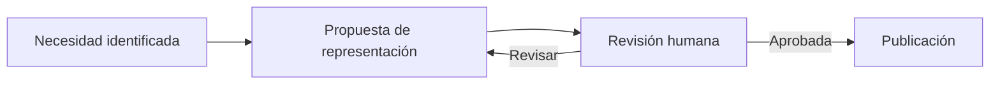

# Aplicación práctica

## Flujo de trabajo

1. Identificar la pregunta que una lectora o agente necesita resolver.
2. Verificar que la fuente textual justifica nodos, conexiones y dirección de flechas.
3. Elegir la representación menos compleja que permita interpretar la respuesta; para grafos Markdown, probar capacidades actuales de Mermaid y la diagramación del visor de destino antes de descartar ese formato.
4. Escribir una interpretación textual y una nota de límites.
5. Revisar accesibilidad, mantenibilidad, coherencia semántica y resultado en el visualizador real. Si Mermaid no ofrece claridad suficiente, evaluar SVG con representación textual alternativa.

## Ejemplo ilustrativo de ciclo

**Cómo leerlo:** ejemplo de un ciclo editorial, no protocolo prescrito para los proyectos de The Alive Lab.

**Límite:** no presupone herramientas concretas, roles fijos ni obligatoriedad de una aprobación formal para cada diagrama.

## Contraste de formatos

Al comparar Mermaid y SVG, evaluar por separado (a) fidelidad a conceptos y relaciones, (b) facilidad de lectura, (c) capacidad de distribución visual, (d) mantenimiento de cambios y (e) accesibilidad. Un mejor layout no implica mayor cobertura semántica. Las capacidades pueden variar por versión y motor: documentar el entorno de renderizado si afecta la conclusión.

Ejemplo abierto: [Lifecycle de TDidacta, Mermaid vs. SVG](https://github.com/the-alive-lab/tdidacta/blob/main/lifecycle/visual-comparison-mermaid-svg.md). Su objetivo es comparar alternativas, no imponer una tecnología.

## Adopción local

Recomendamos enlazar a este repositorio desde el README o AGENTS.md del proyecto consumidor, indicar versión y diferenciar **referencia** de **adopción**. No copiar fragmentos silenciosamente ni hacer que un agente los trate como política superior a la autoridad local.
