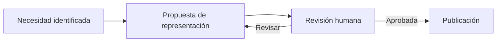

# Aplicación práctica

## Flujo de trabajo

1. Identificar la pregunta que una lectora o agente necesita resolver.
2. Verificar que la fuente textual justifica nodos, conexiones y dirección de flechas.
3. Elegir la representación menos compleja que permita interpretar la respuesta.
4. Escribir una interpretación textual y una nota de límites.
5. Revisar accesibilidad, mantenibilidad y coherencia semántica.

## Ejemplo ilustrativo de ciclo

**Cómo leerlo:** ejemplo de un ciclo editorial, no protocolo prescrito para los proyectos de The Alive Lab.

**Límite:** no presupone herramientas concretas, roles fijos ni obligatoriedad de una aprobación formal para cada diagrama.

## Adopción local

Recomendamos enlazar a este repositorio desde el README o AGENTS.md del proyecto consumidor, indicar versión y diferenciar **referencia** de **adopción**. No copiar fragmentos silenciosamente ni hacer que un agente los trate como política superior a la autoridad local.
